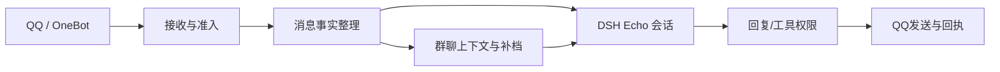

# Echo QQ Bridge

**项目队友：[Peirar](https://github.com/Peirar) · [Terabinaryte](https://github.com/Terabinaryte)**

发起与维护：[Yotaoer](https://github.com/Yotaoer)

DSH Echo渠道插件。仓库名`dsh-qq-bridge`，运行包名仍是`dsh-echo-qq`。人格、记忆与会话由[dsh-memory-agent](https://github.com/Heart3-XDUGT2/dsh-memory-agent)提供，不另建陪伴Agent或迁移数据库。

`0.2.0-preview.1`是GitHub预发布候选，非npm发布或真实账号全功能验收承诺。

界面截图见 [Echo 面板预览](https://github.com/Heart3-XDUGT2/dsh-memory-agent#界面预览)。

## 实际能力

- OneBot11反向WebSocket：准入私聊/群聊、群白名单、群醒/闲置休眠、@对象识别、文本回复/回执。
- 可使用NapCat或SnowLuma：反向客户端、Universal、array及匹配的Bearer token。两套桥不可同时向Echo上报；不同实现的消息ID、文件资源和转发ID不保证互通或跨桥去重。
- 图片交主包附件/识图链；合并转发有界展开；文件先感知再按主包权限读取。语音仅记录收到与确有的时长，**无ASR/转写**。
- `echo_qq_file_send({ref})`提交本轮成功展示、工作区`echo-outgoing`内的非空产物，最大8MiB；仅当前真实QQ主人私聊或准入醒群内主人输入。不选择任意收件人，结果未知不自动重发。
- QQ空间依赖独立空间桥与有效授权/Cookie，换OneBot不等于空间自动支持。

`official/`是独立**默认禁用、明确绑定主人、文字C2C**官方桥；不是群/媒体/主动推送的全能替代，开发权限、账号范围和平台接口限制可能阻碍使用。见[官方说明](official/README.md)。任何桥均**没有防封保证**。

## 它在 Echo 架构中的位置

QQ桥只负责“把QQ上的事实安全地交给Echo，再把Echo明确允许发送的内容送回QQ”。它不拥有记忆库，不实现人格，不单独决定Echo该不该回复，也不替代DSH会话。



### 接收侧

- 统一私聊和群聊信封：当前消息正文、发送者、群号、消息ID、@对象、引用、图片、文件、转发和语音收到事实分别保留。
- 群聊上下文使用有界内存窗口；同群消息按实际收到顺序整理，并保留主人/群友身份、QQ尾号区分、引用ID和是否明确@Echo。
- 主人群聊唤醒可以触发有限补档。补档是“休眠期间群里发生过什么”的背景，不是当前发言，也不自动证明某人对Echo说话。
- 结构化窗口与补档重叠时只提供一份；补档覆盖窗口之外的较早内容时，仍作为未逐条核对的非可信背景交给Echo。

### 发出侧

Echo只有在当前真实会话、当前群目标和工具执行证明都成立时才能发送。桥不会让模型任意指定收件人，也不会把排队、发送尝试和确认送达混为同一个成功状态。

文件发送需要先在本轮输入中真实出现，并且通过当前权限和工作区产物检查；失败或未知结果不会自动重放。图片、文件和转发内容的读取都受大小、数量、时效和来源边界限制。

### 与Echo记忆和情绪的关系

QQ桥传递的是渠道事实：谁发了什么、在哪个群、是否引用、是否@、哪些媒体确实收到。记忆检索、时间纪律、图谱联想、同轮情绪、反思提取和长期写入由[dsh-memory-agent](https://github.com/Heart3-XDUGT2/dsh-memory-agent)负责。

桥接层的群聊上下文可以帮助Echo分清主人和群友，但它不创建长期真人画像，也不把每一条群消息自动写入记忆。Echo在群聊里保留主人关系，不会因为当前群友发言就把群友当成主人。

### 平台与风险边界

- NapCat、SnowLuma等OneBot客户端只是不同的QQ接入实现，不提供官方安全保证。
- `official/`通道默认关闭，面向明确绑定主人的文字C2C；它不是完整群聊、媒体和主动推送替代。
- QQ限制、账号状态、设备环境和平台策略由腾讯及客户端平台决定；本桥不声称防封、改设备指纹或规避风控。
- 语音目前只告诉Echo“收到了语音以及可验证的基础事实”，不等于已经接入ASR。
- 群聊补档、转发、文件和送达状态都可能缺失或不完整；缺失字段会保留未知，不补造。

## 安装与更新

正式基准Node24。用户先自行安装兼容DSH并创建profile；本仓不自动安装大型宿主、登录QQ或改名单。

```powershell
git clone https://github.com/Heart3-XDUGT2/dsh-qq-bridge.git
cd dsh-qq-bridge
npm ci --legacy-peer-deps --ignore-scripts
npm run check
npm test
node scripts/install.mjs --profile web
node scripts/install.mjs --profile web --check
```

**不能省略安装而只跑`--check`**。脚本支持`--help/--doctor/--remove/--profile`，`DSH_HOME`可显式指向沙盒；无参数安装链接源码并登记bundle/dependency，不创建profile或重启DSH。链接后要保留源码目录。

更新：先保留源码修改，取用户选定发布版本，再运行同样的npm ci、安装和check；业务代码需用户在合适时机重载/正常重启DSH，网页静态资源刷新。不要删除业务数据“升级”。

```powershell
node scripts/install.mjs --profile web --remove
```

卸载仅摘本插件登记/安装位，不删QQ账号、Echo记忆或数据。[安装边界](docs/INSTALLATION.md)。

## 开发与打包

`npm test`为独立单元范围；跨仓/真实宿主集成必须另跑，不能称单元绿即全系统绿。见[测试矩阵](docs/TESTING.md)。`npm run pack:check`生成并核两份tgz，不上传npm/GitHub。

[CONTRIBUTING](CONTRIBUTING.md) · [SECURITY](SECURITY.md) · [PRIVACY](PRIVACY.md) · [预发布说明](RELEASE_NOTES.md)。自主代码MIT，第三方权利见[THIRD_PARTY](THIRD_PARTY.md)。
